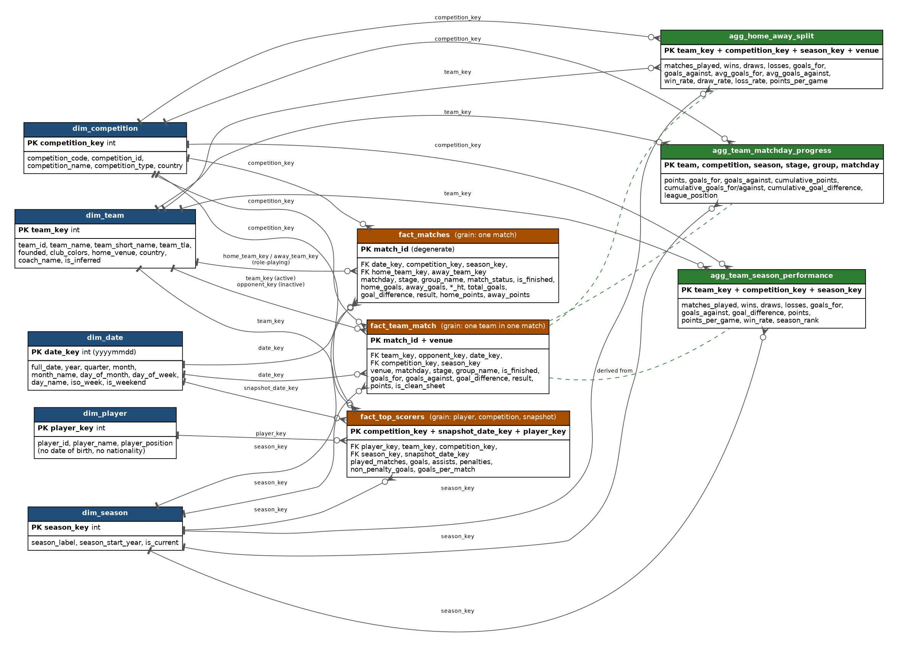

# Gold layer: dimensional model and data dictionary

Source: the football-data.org Silver tables (`silver_matches`, `silver_teams`,
`silver_scorers`). Code: `pipelines/gold/silver_to_gold.py`.
StatsBomb tables stay in Silver; they are not modelled here.

## 1. Schema

A **star schema**: five conformed dimensions, three facts, three aggregates
derived from `fact_team_match`. Relationships are one dimension row to many
fact rows, on integer surrogate keys.

```mermaid
erDiagram
    dim_date        ||--o{ fact_matches       : date_key
    dim_competition ||--o{ fact_matches       : competition_key
    dim_season      ||--o{ fact_matches       : season_key
    dim_team        ||--o{ fact_matches       : "home_team_key, away_team_key"

    dim_date        ||--o{ fact_team_match    : date_key
    dim_competition ||--o{ fact_team_match    : competition_key
    dim_season      ||--o{ fact_team_match    : season_key
    dim_team        ||--o{ fact_team_match    : "team_key, opponent_key"

    dim_date        ||--o{ fact_top_scorers   : snapshot_date_key
    dim_competition ||--o{ fact_top_scorers   : competition_key
    dim_season      ||--o{ fact_top_scorers   : season_key
    dim_team        ||--o{ fact_top_scorers   : team_key
    dim_player      ||--o{ fact_top_scorers   : player_key

    dim_team        ||--o{ agg_team_season_performance : team_key
    dim_competition ||--o{ agg_team_season_performance : competition_key
    dim_season      ||--o{ agg_team_season_performance : season_key
    dim_team        ||--o{ agg_home_away_split         : team_key
    dim_competition ||--o{ agg_home_away_split         : competition_key
    dim_season      ||--o{ agg_home_away_split         : season_key
    dim_team        ||--o{ agg_team_matchday_progress  : team_key
    dim_competition ||--o{ agg_team_matchday_progress  : competition_key
    dim_season      ||--o{ agg_team_matchday_progress  : season_key
```

Every table also carries `load_timestamp`, `batch_id`, `load_type`.

## 2. Tables

### Dimensions

| Table | Grain | PK | Refresh |
|---|---|---|---|
| `dim_date` | one calendar day, first match/snapshot to last | `date_key` (yyyymmdd) | overwrite (deterministic spine) |
| `dim_competition` | one competition | `competition_key` | MERGE, SCD1 |
| `dim_season` | one season label (`2025/26`, or `2026` for calendar-year competitions) | `season_key` | MERGE, SCD1 |
| `dim_team` | one team (`team_id`), however many competitions it plays in | `team_key` | MERGE, SCD1 |
| `dim_player` | one scorer | `player_key` | MERGE, SCD1 |

Each dimension has an `Unknown` member with key `-1`, so a failed lookup still
joins rather than vanishing from a report.

**`dim_competition`**: `competition_key`, `competition_code`, `competition_id`, `competition_name`, `competition_type` (LEAGUE / CUP), `country`.
`competition_type` and `country` come from a hand-maintained map in the code, because the matches payload does not carry them.

**`dim_season`**: `season_key`, `season_label`, `season_start_year`, `is_current`.

**`dim_team`**: `team_key`, `team_id`, `team_name`, `team_short_name`, `team_tla`, `founded`, `club_colors`, `home_venue`, `country`, `coach_name`, `is_inferred`.
`is_inferred = true` marks a team that appears in a match or scorer row but not in the teams feed (69 of 315 team ids in the full load). It gets a stub row with name and TLA only, instead of an orphaned foreign key, and is enriched in place if the teams feed later covers it.

**`dim_player`**: `player_key`, `player_id`, `player_name`, `player_position`.

**`dim_date`**: `date_key`, `full_date`, `year`, `quarter`, `month`, `month_name`, `day_of_month`, `day_of_week` (1 = Sunday), `day_name`, `iso_week`, `is_weekend`.

### Facts

| Table | Grain | PK | Refresh |
|---|---|---|---|
| `fact_matches` | one match | `match_id` | MERGE |
| `fact_team_match` | one team in one match (two rows per match) | `match_id` + `venue` | MERGE |
| `fact_top_scorers` | one player, one competition, one snapshot date | `competition_key` + `snapshot_date_key` + `player_key` | MERGE |

**`fact_matches`**: FKs `date_key`, `competition_key`, `season_key`, `home_team_key`, `away_team_key`; `match_id` (degenerate), `kickoff_utc`, `matchday`, `stage`, `group_name`, `match_status`, `is_finished`; measures `home_goals`, `away_goals`, `home_goals_ht`, `away_goals_ht`, `total_goals`, `goal_difference` (home minus away), `home_points`, `away_points`; `result` (HOME_WIN / AWAY_WIN / DRAW), `source_last_updated`.

**`fact_team_match`**: FKs `team_key`, `opponent_key`, `date_key`, `competition_key`, `season_key`; `match_id`, `venue` (HOME / AWAY), `kickoff_utc`, `matchday`, `stage`, `group_name`, `match_status`, `is_finished`; measures `goals_for`, `goals_against`, `goal_difference`, `points`, `is_clean_sheet`; `result` (WIN / DRAW / LOSS).

**`fact_top_scorers`**: FKs `player_key`, `team_key`, `competition_key`, `season_key`, `snapshot_date_key`; `snapshot_date`; measures `played_matches`, `goals`, `assists`, `penalties`, `non_penalty_goals`, `goals_per_match`.

Goal and point measures are populated only when `is_finished` and both scores are present. Postponed, scheduled and **awarded** (walkover) matches have no goals or points in Gold.

### Aggregates (recomputed in full, from `fact_team_match`)

| Table | Grain | PK |
|---|---|---|
| `agg_team_season_performance` | team, competition, season | `team_key` + `competition_key` + `season_key` |
| `agg_home_away_split` | team, competition, season, venue | the above + `venue` |
| `agg_team_matchday_progress` | team, competition, season, stage, group, matchday | all six |

`agg_team_season_performance`: `matches_played`, `wins`, `draws`, `losses`, `goals_for`, `goals_against`, `goal_difference`, `points`, `points_per_game`, `win_rate`, `season_rank`. Rank is only meaningful where `dim_competition.competition_type = 'LEAGUE'`.

`agg_home_away_split`: `matches_played`, `wins`, `draws`, `losses`, `goals_for`, `goals_against`, `avg_goals_for`, `avg_goals_against`, `win_rate`, `draw_rate`, `loss_rate`, `points_per_game`.

`agg_team_matchday_progress`: `points`, `goals_for`, `goals_against`, `cumulative_points`, `cumulative_goals_for`, `cumulative_goals_against`, `cumulative_goal_difference`, `league_position`. League and group stages only (`REGULAR_SEASON`, `LEAGUE_STAGE`, `GROUP_STAGE`). Position is among teams that have a result for that matchday, so a postponed match can shift it temporarily.

This third aggregate is an addition to the Phase 1 plan: a cumulative-points-by-matchday line chart cannot be drawn from a season-grain table.

## 3. Design decisions

**Surrogate keys are deterministic hashes** of the natural key (`pmod(xxhash64(id), 2^31-1)`), not identity columns or `row_number()`. Those would give the same team a different number after a rebuild, which breaks MERGE and orphans fact rows. The key is 31 bits so it survives Power BI and Tableau, which lose precision above 2^53. A hash can in principle collide, so `validate_gold()` checks key uniqueness on every dimension instead of assuming it.

**Two team-keyed facts.** `fact_matches` (one row per match) answers match-level questions but needs two team keys, a role-playing dimension. `fact_team_match` unpivots it to one row per team per match, so "team form" and "home vs away" are a single relationship to `dim_team`. In Power BI keep `home_team_key` active on `fact_matches` and `team_key` active on `fact_team_match`; make `away_team_key` and `opponent_key` inactive and use `USERELATIONSHIP` when needed.

**Refresh strategy follows the table's role.** Dimensions and facts MERGE on their key, so a corrected score updates a row. Aggregates are overwritten, because one corrected result changes every cumulative figure after it and there is no row-level key to merge on. `dim_date` is a deterministic spine, so it is overwritten.

**No partitioning on Gold.** The largest table has about 28,000 rows. Partitioning would only create small files. Instead the three facts are clustered (liquid clustering, falling back to Z-ORDER then plain `OPTIMIZE`) on `competition_key`/`season_key`, `team_key`/`season_key`, and `competition_key`/`snapshot_date_key`. At this volume the gain is small; it is there so the design holds if the data grows.

## 4. PII

Phase 1 (section 3.2) classed player date of birth and nationality as quasi-identifiers: kept in Silver, excluded from any Gold table that is shared. `dim_player` is the table Power BI reads, so it carries name and position only. `coach_nationality` is excluded from `dim_team` for the same reason. If a visual needs age or nationality, generalise it (an age band, a region) in Gold rather than exposing the raw value.

## 5. Quality gates (`validate_gold`)

Run after every Gold refresh, one audit row each (layer `Gold-Validation`): grain uniqueness on all 11 tables, and every foreign key on every fact and aggregate resolves to a dimension row. `rows_read` is rows tested, `rows_quarantined` is violations. All checks run before anything raises, so one failure does not hide another.

## 6. Pipeline integration

`pipelines/run_pipeline.py` runs Bronze, Silver and Gold as stages of one run under one batch id. `workflows/football_lakehouse_daily_job.json` defines them as three dependent Databricks Workflow tasks on a daily schedule; Gold only starts if Silver succeeded. Gold writes to the same `ops/pipeline_execution_logs` table as the earlier layers (layer `Silver-to-Gold`), with rows read (rows aggregated), rows inserted, rows updated and `duration_seconds`.
